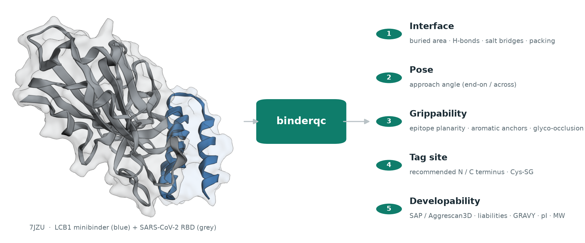

<h1 align="center">binderqc</h1>

<p align="center">
  Quality control and tag-site scoring for designed protein binders.
</p>

<p align="center">
  <a href="https://pypi.org/project/binderqc/"></a>
  <a href="https://github.com/ssiddhantsharma/binderqc/actions/workflows/ci.yml"></a>
  <a href="https://opensource.org/licenses/MIT"></a>
  <a href="https://www.python.org/"></a>
  <a href="https://doi.org/10.5281/zenodo.21529428"></a>
</p>

<p align="center">
  
</p>

## Install

```bash
pip install binderqc
```

Python 3.10+. Pulls in `biotite`, `numpy`, and `pandas`. To develop from source,
`pip install -e ".[test]"`.

## Usage

```bash
binderqc --binder-chains A --target-chains B --out out.csv complex.cif some_dir/
```

```python
from binderqc import score_structure
rows = score_structure("complex.pdb", binder_chains=["A"], target_chains=["B"])
```

Inputs are PDB/CIF files, globs, or directories. Leave `--binder-chains` off to
guess the binder as the shortest chain (20-250 aa, printed for each file).
`--target-chains` defaults to the remaining chains.

| flag | default | meaning |
|---|---|---|
| `--binder-chains` | auto-guess | comma-separated binder chain ids |
| `--target-chains` | all non-binder | comma-separated target chain ids |
| `--interface-cutoff` | `5.0` | heavy-atom contact distance (Å) |
| `--exposure-cutoff` | `0.25` | relSASA below which a terminus is buried |
| `--out` | `binderqc.csv` | output CSV path |
| `-j`, `--jobs` | `1` | worker processes to score a batch of files in parallel |
| `--fasta` | off | also write the QC-passing binders to this FASTA |
| `--self-fold` | off | predicted binder homodimer(s), a file or a directory matched by filename stem: adds where the binder self-associates relative to its paratope |

Scoring is CPU-only: no folding, no GPU, no network. Files in a batch are
independent, so `-j` scales near-linearly across cores on large directories.

Example output for the bundled LCB1 minibinder (a few of the columns):

| recommended_tag | binder_bsa | epitope_planarity | epitope_aromatic_n | pi | qc_pass |
|---|---|---|---|---|---|
| C | 1021.4 | 3.21 | 11 | 4.17 | True |

Its `warnings` field reads "both termini ~equidistant from interface (ambiguous)",
a tag-site advisory, so `qc_pass` stays `True`.

## What it reports

Per binder chain. Every number is CPU-only — no folding, no GPU, no network.

**Interface** — buried surface area, interface residue count, H-bonds, salt bridges,
contact-packing density, and buried unsatisfied polar atoms (`buns_interface`,
`interface_polar_satisfied_frac`). The last is the signal that separates a real
H-bond-satisfied interface from a floppy one (Stranges & Kuhlman 2013; Cao et al. 2022).

**Pose** — approach angle: end-on versus lying across the surface.

**Grippability** — epitope planarity, hydrophobic fraction, aromatic anchors, and a
glycan-occlusion flag (below). `grippability_consensus(row, iara_score)` optionally
cross-checks this physical read against a learned target-side score and returns
`grippable`, `flat`, or `disagree`.

**Tag site** — recommended terminus (N/C) with the numbers behind it: relative SASA,
CA–CA distance to the paratope, orientation, and a terminal cysteine's SG SASA.

**Self-association** (`--self-fold`) — given a predicted binder homodimer, how much of the
paratope the self-interface buries, and whether that is more than a patch of that size
would bury sitting anywhere at random. Interface PAE, ipTM and ipSAE say whether a
self-interface is predicted; they cannot say *where*. Away from the paratope that is a
formulation problem; through it, it competes with target binding. `self_verdict` bands at
0.5 and 0.2 — a stated convention, not a fitted cutoff: no dataset of de-novo binders with
measured self-association exists to calibrate on.

**Developability** — reported numbers, not gates. Published thresholds here were calibrated
on antibody Fv surfaces or on 52–65-residue binders and do not transfer cleanly.

| group | columns | note |
|---|---|---|
| aggregation | `sap_score`, `sap_total`, `sap_per_res` | `sap_total` scales with length, so `sap_per_res` is the comparable one |
| aggregation | `a3d_score`, `a3d_total_positive` | pure-Python Aggrescan3D 1.0.2 port, Pearson r≈0.92 vs the reference tool |
| surface charge | `charge_patch_pos`, `charge_patch_neg` | strongest exposed like-charge clusters (Raybould et al. 2019) — what net charge and pI miss, and what drives viscosity |
| paratope-scoped | `paratope_hydrophobicity`, `paratope_charge` | is the *interface itself* sticky or charge-clumped |
| nonspecific stickiness | `net_charge`, `lys_arg_pct` | whole-binder, not paratope. Of 25 measures tested against BVP-ELISA and ovalbumin polyreactivity (211 designs, two CROs) these correlated best: ρ=−0.57 and ρ=0.50 |
| classical | `instability_index`, `gravy`, `pi`, `mw`, `ext_coeff_280` | ProtParam (Guruprasad 1990) |

**Sequence liabilities** — unpaired cysteines, N-glycosylation sequons, polybasic and
hydrophobic runs, histidine runs (confounds IMAC and reads like an affinity tag), and
Met/Trp oxidation hotspots. Deamidation (N-[G/S/T]) and Asp isomerization (D-[G/S/T/D/H])
are flagged **only when solvent-exposed** — a buried motif reacts far more slowly
(Sydow et al. 2014), so a sequence-only hit over-predicts.

### Glycan occlusion, and what this is not

`epitope_glyco_occluded` / `epitope_glyco_sites` flag N-glycosylation sequons
(N-X-[S/T], X≠P) on the **target** that are both solvent-exposed and near the epitope,
where an installed glycan would mask an otherwise grippable patch.

Two details make it more than a sequence grep:

- exposure is measured on the **free target**, not the complex. Glycans are installed
  before the binder arrives, and in the complex an engaged epitope Asn reads as buried —
  so complex SASA would hide exactly the sites that matter.
- sequons are read off the modeled chain, so a gap from an unresolved loop cannot
  fabricate a phantom site.

**It is a proximity flag, not a glycan model.** The test is: sequon, exposed
(relSASA ≥ 0.20), within 10 Å of the epitope. It does not build glycan conformations, so
it cannot tell you *how much* of the accessible ensemble is blocked, and it says nothing
about the entropic cost of a binder that restricts glycan flexibility — which can hurt
affinity even when the pose is sterically fine.

For that, use [GlycoSHIELD](https://gitlab.mpcdf.mpg.de/dioscuri-biophysics/glycoshield-md)
(Gecht et al., [doi:10.1101/2021.08.04.455134](https://doi.org/10.1101/2021.08.04.455134)):
graft conformer ensembles onto the site and ask what fraction stays compatible with each
pose. The sensible division of labour is to let binderqc flag the sites cheaply across a
whole batch, then run GlycoSHIELD on the candidates that survive.

A `warnings` column flags problems: small, flat, anchorless, or glyco-occluded
interfaces; buried, ambiguous, or interface-facing tag sites; hydrophobic
sequences. `qc_pass` is true when there are no quality warnings (tag-site
advisories like an ambiguous terminus do not count), and `--fasta` writes those
binders.

<details>
<summary>Full column list</summary>

`pdb, binder_chain, target_chains, n_interface_res, binder_bsa, n_hbonds,
n_salt_bridges, buns_interface, interface_polar_satisfied_frac, interface_packing, approach_angle, epitope_planarity,
epitope_hydrophobic_frac, epitope_aromatic_n, epitope_glyco_occluded,
epitope_glyco_sites, nterm_resnum, nterm_resname,
nterm_relsasa, nterm_dist_to_interface, nterm_orientation, nterm_sg_sasa,
cterm_resnum, cterm_resname, cterm_relsasa, cterm_dist_to_interface,
cterm_orientation, cterm_sg_sasa, recommended_tag, mw, gravy, pi, net_charge,
lys_arg_pct, instability_index, ext_coeff_280, sap_score, sap_total, sap_per_res, a3d_score,
a3d_total_positive, charge_patch_pos, charge_patch_neg, paratope_hydrophobicity,
paratope_charge, paratope_res, sequence_liabilities, warnings, qc_pass,
binder_sequence`

With `--self-fold`, also `self_fold, self_bsa, self_n_interface_res,
self_paratope_overlap_n, self_paratope_overlap_frac, self_paratope_enrichment,
self_verdict, residues_matched`.

</details>

The literature basis for each developability metric — and which are well-supported
versus weak heuristics you should report but not gate on — is in
[DEVELOPABILITY.md](DEVELOPABILITY.md).

## Tests

```bash
pip install -e ".[test]"
pytest
```

Tests run against a bundled example, PDB 7JZU (the LCB1 minibinder on the
SARS-CoV-2 RBD). LCB1 comes from Cao et al. (2020), which frames the problem
binderqc targets: the bottleneck is selecting good binders, not designing them.

> "…not in the de novo design of proteins with shape and chemical complementarity
> to the target surface, but in recognizing the best candidates."

In that work LCB1 buries ~1,000 Ų and forms "multiple hydrogen bonds and salt
bridges … consistent with the subnanomolar affinities". binderqc on 7JZU agrees:
1021 Ų buried area (Cao reports ~1,000 Ų), plus 2 salt bridges and 17 interface
polar contacts. See Cao et al., *De novo design of picomolar SARS-CoV-2
miniprotein inhibitors*, Science 370, 426-431 (2020),
[doi:10.1126/science.abd9909](https://doi.org/10.1126/science.abd9909).

`tests/pisa_correctness.py` is a separate script, not part of the unit tests. It
downloads 18 public complexes from RCSB and PDBePISA and checks the interface area
against PISA (r ~ 1.0, about 1% median error):

```bash
pip install -e ".[validation]"
python tests/pisa_correctness.py
```

## Figures

The complex in the banner is a real render, not a drawing. `docs/render_structure.py`
draws a cartoon under a translucent molecular surface (binder blue, target grey)
from actual coordinates, using 3Dmol.js in headless Chromium. It works on any
PDB/CIF, so you can reuse it for your own figures:

```bash
pip install -e ".[docs]" && python -m playwright install chromium
python docs/render_structure.py complex.pdb A B out.png   # structure, binder chain, target chain, output
```

## License

MIT
