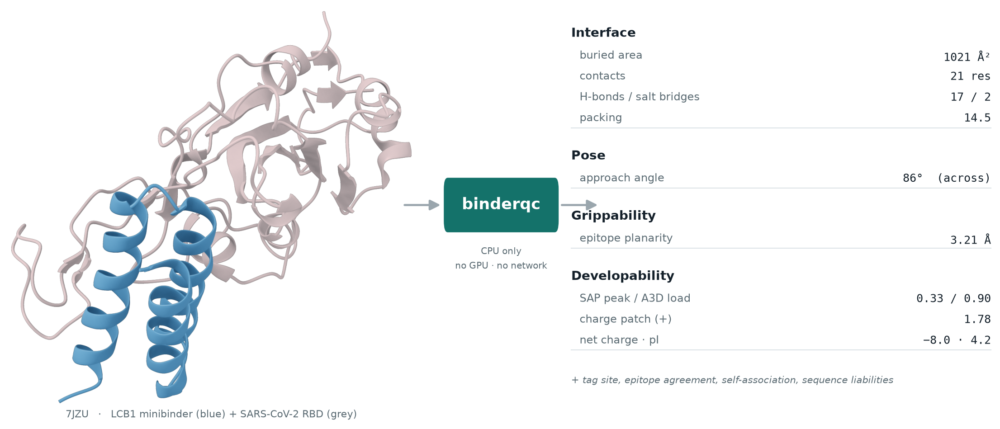

<h1 align="center">
  &nbsp;binderqc
</h1>

<p align="center">
  Quality control and tag-site scoring for designed protein binders.
</p>

<p align="center">
  <a href="https://pypi.org/project/binderqc/"></a>
  <a href="https://github.com/ssiddhantsharma/binderqc/actions/workflows/ci.yml"></a>
  <a href="https://opensource.org/licenses/MIT"></a>
  <a href="https://www.python.org/"></a>
  <a href="https://doi.org/10.5281/zenodo.21529428"></a>
</p>

<p align="center">
  
</p>

## Why this exists

A de novo binder that folds and scores well in silico can still fail for physical
reasons a confidence metric cannot see: an interface too small to hold, a paratope
that will stick to itself, an aggregation-prone surface, a conjugation site pointing
into the target. Those questions are answered by coordinates, not by ipTM or PAE.

Most tooling for them is either locked to antibodies (TAP's thresholds are
calibrated on Fv surfaces), scattered across web servers that take one structure at
a time, or bundled into Rosetta. **binderqc puts the physical checks in one
CPU-only, model-agnostic package**: hand it a finished complex from any source —
AlphaFold, Protenix, Boltz, Chai, a crystal structure — and it returns an auditable
panel per binder chain, with no GPU, no network, and no trained model. It is for
people deciding which designs to order, and for anyone wanting a physical second
opinion on a prediction that already looks confident.

[METHODS.md](METHODS.md) defines every column — the formula, its source, and where
this implementation departs from that source — so a reported value can be checked
rather than trusted. binderqc deliberately does **not** compute ipSAE or other
confidence metrics: those need PAE rather than coordinates, that space is well
served, and staying model-agnostic is what lets one panel compare structures from
different predictors.

## Install

```bash
pip install binderqc
```

Python 3.10+. Pulls in `biotite`, `numpy`, and `pandas`. To develop from source,
`pip install -e ".[test]"`.

## Usage

```bash
binderqc --binder-chains A --target-chains B --out out.csv complex.cif some_dir/
```

```python
from binderqc import score_structure
rows = score_structure("complex.pdb", binder_chains=["A"], target_chains=["B"])
```

Inputs are PDB/CIF files, globs, or directories. Leave `--binder-chains` off to
guess the binder as the shortest chain (20-250 aa, printed for each file).
`--target-chains` defaults to the remaining chains.

| flag | default | meaning |
|---|---|---|
| `--binder-chains` | auto-guess | comma-separated binder chain ids |
| `--target-chains` | all non-binder | comma-separated target chain ids |
| `--interface-cutoff` | `5.0` | heavy-atom contact distance (Å) |
| `--exposure-cutoff` | `0.25` | relSASA below which a terminus is buried |
| `--epitope` | off | the target site the design was meant to hit, e.g. `B:45,47,50-58`; adds `epitope_contact_fraction` and `epitope_coverage` |
| `--degradation-context` | `complex` | exposure convention for the oxidation/deamidation flags: `complex` (exposed while bound) or `free` (binder alone in solution) |
| `--out` | `binderqc.csv` | output CSV path |
| `-j`, `--jobs` | `1` | worker processes to score a batch of files in parallel |
| `--fasta` | off | also write the QC-passing binders to this FASTA |
| `--self-fold` | off | predicted binder homodimer(s), a file or a directory matched by filename stem: adds where the binder self-associates relative to its paratope |

### Did it bind where you asked?

Every other epitope column describes whatever patch the structure happens to
show, so none of them can tell you a design drifted. Declare the intended site
and two columns can:

```bash
binderqc --epitope "B:417,445,446,449,453,455,456" complex.pdb
```

`epitope_contact_fraction` is the share of contacted target residues that were
declared (did it stay on-site) and `epitope_coverage` the share of the declared
site it actually touched (how much of it it used). Both are reported because
either alone misleads: a design gripping three residues of a twenty-residue
epitope scores a perfect fraction. Declared residues absent from the structure
are counted in `epitope_declared_missing` rather than quietly dropped, since a
mistyped residue number otherwise flatters both numbers. Chain prefixes are
required — a bare residue number is rejected rather than guessed at.

### Two exposure conventions, on purpose

Exposure is computed either on the **complex** (is this site exposed while bound?)
or on the **free** binder (is it exposed in solution?). Aggregation and patch
columns always use `free`, because that is how their source definitions are
written; `--degradation-context` picks the convention for the oxidation and
deamidation checks. Mixing them silently is the failure mode —
see [METHODS.md](METHODS.md#the-two-exposure-conventions).

## What it reports

Per binder chain, all CPU-only. Formulas and sources: [METHODS.md](METHODS.md).

**Interface** — buried surface area, interface residue count, H-bonds, salt bridges,
contact-packing density, and buried unsatisfied polar atoms (`buns_interface`,
`interface_polar_satisfied_frac`). The last is the signal that separates a real
H-bond-satisfied interface from a floppy one (Stranges & Kuhlman 2013; Cao et al. 2022).

**Pose** — approach angle: end-on versus lying across the surface.

**Grippability** — epitope planarity, hydrophobic fraction, aromatic anchors, and a
glycan-occlusion flag (below). `grippability_consensus(row, iara_score)` optionally
cross-checks this physical read against a learned target-side score and returns
`grippable`, `flat`, or `disagree`.

**Tag site** — recommended terminus (N/C) with the numbers behind it: relative SASA,
CA–CA distance to the paratope, orientation, and a terminal cysteine's SG SASA.

**Self-association** (`--self-fold`) — given a predicted binder homodimer, how much of
the paratope the self-interface buries, and whether that exceeds what a patch of that
size would bury at random. Interface PAE, ipTM and ipSAE say whether a self-interface is
predicted; they cannot say *where*. Away from the paratope that is a formulation problem;
through it, it competes with target binding. `self_verdict` bands at 0.5 and 0.2 are a
stated convention, not a fitted cutoff — no dataset of de-novo binders with measured
self-association exists to calibrate on.

**Developability** — reported numbers, not gates. Published thresholds here were calibrated
on antibody Fv surfaces or on 52–65-residue binders and do not transfer cleanly.

| group | columns | note |
|---|---|---|
| aggregation | `sap_score`, `sap_total`, `sap_per_res` | `sap_total` scales with length, so `sap_per_res` is the comparable one |
| aggregation | `a3d_score`, `a3d_total_positive` | pure-Python Aggrescan3D 1.0.2 port, Pearson r≈0.92 vs the reference tool |
| surface charge | `charge_patch_pos`, `charge_patch_neg` | strongest exposed like-charge clusters (Raybould et al. 2019) — what net charge and pI miss, and what drives viscosity |
| paratope-scoped | `paratope_hydrophobicity`, `paratope_charge` | is the *interface itself* sticky or charge-clumped |
| nonspecific stickiness | `net_charge`, `lys_arg_pct` | whole-binder, not paratope. Of 25 measures tested against BVP-ELISA and ovalbumin polyreactivity (211 designs, two CROs) these correlated best: ρ=−0.57 and ρ=0.50 |
| classical | `instability_index`, `gravy`, `pi`, `mw`, `ext_coeff_280` | ProtParam (Guruprasad 1990) |

**Sequence liabilities** — unpaired cysteines, N-glycosylation sequons, polybasic and
hydrophobic runs, histidine runs (confounds IMAC and reads like an affinity tag), and
Met/Trp oxidation hotspots. Deamidation (N-[G/S/T]) and Asp isomerization (D-[G/S/T/D/H])
are flagged **only when solvent-exposed** — a buried motif reacts far more slowly
(Sydow et al. 2014), so a sequence-only hit over-predicts.

### Glycan occlusion

Sequons on the **target** that are both exposed and at the epitope, where an
installed glycan would mask the patch for a small binder. Exposure is measured on
the target alone, and sequons are read off modelled residues so an unresolved loop
cannot fabricate one. This flags a site worth checking, not a verified glycan —
see [METHODS.md](METHODS.md#grippability).

## Tests

```bash
pip install -e ".[test]"
pytest
```

Tests run against a bundled example, PDB 7JZU — the LCB1 minibinder on the
SARS-CoV-2 RBD, from Cao et al. (2020), which states the problem binderqc exists
for: the bottleneck is "not in the de novo design of proteins with shape and
chemical complementarity to the target surface, but in recognizing the best
candidates."

binderqc's numbers agree with that paper's: 1021 Ų buried (Cao reports ~1,000 Ų),
2 salt bridges and 17 interface polar contacts against its "multiple hydrogen bonds
and salt bridges … consistent with the subnanomolar affinities". Cao et al.,
*De novo design of picomolar SARS-CoV-2 miniprotein inhibitors*, Science 370,
426-431 (2020), [doi:10.1126/science.abd9909](https://doi.org/10.1126/science.abd9909).

`tests/pisa_correctness.py` is a separate script, not part of the unit tests. It
downloads 18 public complexes from RCSB and PDBePISA and checks the interface area
against PISA (r ~ 1.0, about 1% median error):

```bash
pip install -e ".[validation]"
python tests/pisa_correctness.py
```

## Figures

The banner is a real render and the numbers beside it are 7JZU's actual
`score_structure` row, not illustrative values. Rebuild it with
`python docs/make_schematic.py`.

`docs/render_structure.py` renders any PDB/CIF headlessly via 3Dmol.js and is
reusable for your own figures (`pip install -e ".[docs]"`). The banner itself
uses [chimenodes](https://github.com/anirudhbhashyam/chimenodes); see the header
of `docs/render_chimenodes.cxc` for why that one cannot run in CI.

## Contributing

Bug reports, questions and patches are all welcome — see
[CONTRIBUTING.md](CONTRIBUTING.md) for how to report a problem, what a good
reproducer looks like, and how to run the tests.

## Citing

[CITATION.cff](CITATION.cff), or the Zenodo DOI in the badge above.

## License

MIT
